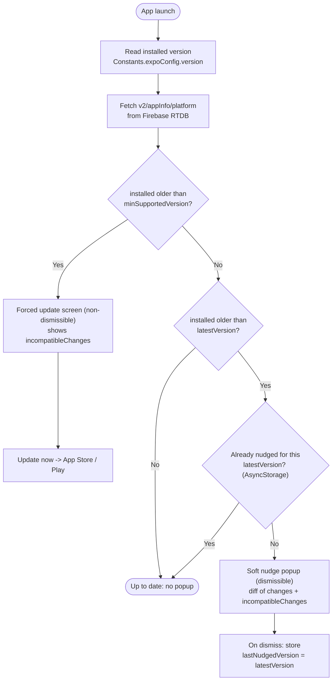
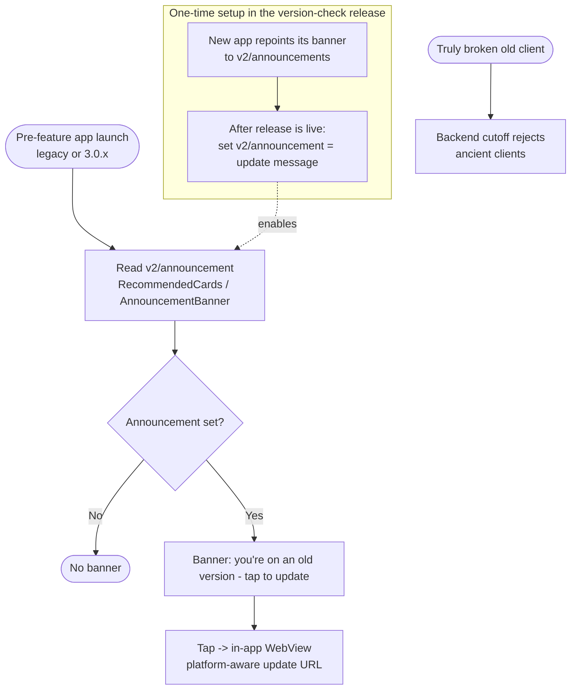

# Version Check & Update Notification

Plan for a system that detects when a user is running an outdated app and
nudges (or, for breaking releases, forces) them to update — while clearly
telling them what they are missing, so we stop "feature X doesn't work"
reports from people on old versions.

Status: **planning**. Decisions below are locked from the design review;
items marked _Open_ still need a call.

---

## Goals

- Tell users on an old version that they are behind, and **what they gain**
  by updating (concise, from the changelog).
- Support two tiers:
  - **Soft nudge** — dismissible "update available" popup.
  - **Forced update** — non-dismissible gate for releases that break old
    clients.
- Avoid support tickets from users whose app silently stopped working after a
  backend/data-contract change.

### What an "incompatible change" looks like

**Going forward — apps that have this version-check feature (this release onward):**

- *New feature the old app can't render.* e.g. 3.3.0 adds a new project type;
  those projects won't open on < 3.3.0. → added to `incompatibleChanges` for
  3.3.0. A user on 3.2.0 gets the **soft nudge** explaining "new X projects need
  the latest app," so they don't file "this project won't open."
- *Backend / data-contract change that breaks old clients.* e.g. 3.5.0 changes
  the contribution payload and the backend stops accepting the old shape, so
  submissions on < 3.5.0 silently fail. → listed in `incompatibleChanges` **and**
  `minSupportedVersion` bumped to 3.5.0 → those users get the **forced-update**
  gate instead of a silently broken app.
- The rule of thumb: *new-but-unusable* → soft nudge (messaging only);
  *your-app-no-longer-works* → force via `minSupportedVersion`.

**Before this — pre-feature apps (legacy + 3.0.x shipped before this release):**

- They can't receive the targeted popup or compute a per-version diff — they only
  render the `v2/announcement` banner. So an incompatible change reaches them as
  either a **silently broken experience** (a project won't load, a submission
  fails) or, better, the **repurposed announcement banner**: a generic "You're on
  an old version — some projects or features may not work. Tap to update."
- They can't be told *which specific* feature broke (no per-version data on an
  old binary), so the message stays generic. For truly-broken cases the real
  enforcement is the **backend cutoff**, with the banner as the heads-up.

## Non-goals / reality checks

- **The version-check popup only works for apps that already contain the
  check.** A user on a build shipped *before* this feature cannot be shown the
  new popup — you cannot inject UI into an already-released binary.
  - **Big exception:** both the **legacy app** (pre-3.0.0 codebase) and the new
    app (**3.0.0+**) read the *same* remote announcement node `v2/announcement`
    with the *same* `{text, url}` shape, so we can nudge essentially the
    **entire field population** through it — see
    [Reaching already-shipped apps](#reaching-already-shipped-apps-via-the-announcement-channel).
  - The remaining lever for *forcing* (vs nudging) the un-upgradeable tail is a
    **backend-side cutoff** (server rejecting ancient clients).
- The in-app forced update is a *graceful* version of what the backend would
  otherwise do ungracefully when it drops support for an old client.

---

## Design decisions (locked)

| Decision | Choice |
| --- | --- |
| Source of truth | **Firebase Realtime Database**, already wired (`utils/firebase.ts`, `onValue`) |
| Node | **Per-platform**: `v2/appInfo/{ios,android,web}` |
| Why per-platform | iOS/Android approve & ship on different timelines; **web will have a completely different versioning scheme** |
| Comparison | **Client-side**: installed version (`Constants.expoConfig?.version`) vs remote `latestVersion` |
| Tiers | `latestVersion` → soft nudge; `minSupportedVersion` → forced update |
| Per-release payload | `{ changes: string[], incompatibleChanges: string[] }` (either list may be empty) |
| When Firebase is updated | **After the release is actually live in the store**, not at tag time (avoids nagging toward a not-yet-available version) |
| Version comparison key | **semver string** compare (tiny local comparator or a small dep like `compare-versions`); **not** the Android `versionCode` (won't generalize to web) |
| Localization | **Not now** — changelog text and popup chrome stay English for the first iteration; revisit later |
| Soft-nudge cadence | **Once per `latestVersion`** (AsyncStorage key `@lastNudgedVersion`) |
| `appInfo` writer | **Release CI**, post-store-availability; `minSupportedVersion` bumped manually for breaking releases |
| Sequencing | Instrument real app version first → collect distribution → only then enable force-update at a safe floor |

---

## Flows

### Versions going forward (apps that have the version-check feature)



### Versions before this (pre-feature apps: legacy + 3.0.x)



## Firebase data model

```jsonc
// v2/appInfo/ios   (and /android, and later /web)
{
  "latestVersion": "3.0.9",        // newest version actually live in the store
  "minSupportedVersion": "3.0.0",  // anything below this is force-updated
  "releases": {
    "3.0.8": { "changes": ["…"], "incompatibleChanges": [] },
    "3.0.9": { "changes": ["…"], "incompatibleChanges": [] },
    "3.1.0": {
      "changes": ["New project filters"],
      "incompatibleChanges": ["Projects created after 3.1.0 will not open on older apps"]
    }
  }
}
```

- `releases` mirrors `changeLog.json` plus an `incompatibleChanges` list, so the
  CI can push it directly.
- **`incompatibleChanges` is a messaging list** — it holds both true breaking
  changes *and* new features that simply won't work on older versions ("what you
  can't use / what stopped working until you update"). It does **not** by itself
  force an update; forcing is governed **solely** by `minSupportedVersion`, which
  is bumped manually when a release genuinely must lock out older clients.
- **Security rules:** read allowed (public or any authenticated user); write
  restricted to admin/service account only. Add to the Firebase rules repo.

---

## Work: App (mapswipe-mobile)

### A. Telemetry first (unblocks the force-update floor)
- [ ] Fix the hardcoded app version so we learn the real field distribution.
      `app/(auth)/project/[id]/map/[taskGroupId].tsx:149`
      ```js
      // FIXME: add actual appVersion and clientType
      appVersion: '3.0.0 (0)-dev',
      ```
      Write the real `Constants.expoConfig?.version` (+ build + platform /
      clientType). The `appVersion` field already exists in
      `utils/firebase-generated-types.ts`, so contributions will immediately
      start carrying it → query the distribution from the DB.
- [ ] (Optional) stamp `v2/users/{uid}/appVersion` on launch for a per-user
      "last seen version".

### B. Read the remote appInfo
- [ ] Add a hook/service (e.g. `hooks/useAppInfo.ts`) that reads
      `v2/appInfo/{platform}` using the existing `firebaseRef` + `onValue`
      pattern (see `app/_layout.tsx`). Platform from `Platform.OS`.

### C. Version comparison + diff
- [ ] Add a semver comparator util (`utils/version.ts`): `isOlder(a, b)`.
- [ ] Floor-clamp rules:
  - If `expoConfig.version` is missing/unreadable → treat as very old.
  - If installed version is **below the lowest `releases` key** → clamp to the
    floor and show everything from there.
- [ ] Compute the diff: all `releases` with version `> installed` and
      `<= latest`; aggregate their `changes` and `incompatibleChanges`.

### D. The popup(s)
- [ ] **Forced update** (installed `< minSupportedVersion`): non-dismissible
      screen/modal, no close button, "Update now" → store deep link. Should
      also surface the relevant `incompatibleChanges`.
- [ ] **Soft nudge** (`minSupportedVersion <= installed < latestVersion`):
      dismissible modal listing new `changes` (and any `incompatibleChanges` as a
      prominent "these need the update" note). Shown once per `latestVersion`
      (AsyncStorage key, e.g. `@lastNudgedVersion`).
- [ ] Store deep links for the "Update" button:
  - iOS: `itms-apps://apps.apple.com/app/id<APPLE_APP_ID>`
  - Android: `market://details?id=org.missingmaps.mapswipe`
- [ ] Popup chrome strings stay **English for now** (localization deferred per
      decision). Keep them in one place so they can move to i18n (`i18n.ts`,
      `public/locales/<lang>/…`) later without reworking the components.

### E. Reconcile with existing `ChangeLogModal`
- [ ] `components/ChangeLogModal.tsx` already shows "MapSwipe has been updated!"
      for the **current** version right after updating (bundled
      `changeLog.json`, `@lastViewedChangelogVersion`). Decide: keep it as the
      post-update "what's new", and add the new **pre-update** nudge/force as a
      separate component — or merge both into one update component. Recommend
      keeping post-update separate; the new work is the *behind-the-latest*
      path. Both are mounted in `app/_layout.tsx`.

---

## Work: Firebase + Release CI

- [ ] Create `v2/appInfo/{ios,android}` nodes (seed with current values).
- [ ] Add security rules: public/auth read, admin-only write.
- [ ] Extend **`changeLog.json`** schema to carry incompatible changes per version:
      `{ "3.1.0": { "changes": [...], "incompatibleChanges": [...] } }`
      (today it is `{ changes: [...] }` only). Keep `incompatibleChanges: []` when
      none. Update the in-app readers accordingly.
- [ ] Release CI: **after store approval/availability**, update
      `appInfo/{platform}.latestVersion` and push that release's
      `{ changes, incompatibleChanges }` from `changeLog.json`. (This is distinct
      from the GitHub Release notes we already generate at tag time — those run
      at tag time; the Firebase update must wait for store availability.)
- [ ] Bump `minSupportedVersion` **manually** as part of shipping a breaking
      release, once the field distribution makes the lockout acceptable.

---

## Work: MapSwipe Web (future)

- [ ] Separate `v2/appInfo/web` node with its **own versioning scheme** (web is
      not semver-aligned with mobile; define its version source — build hash /
      date / independent semver).
- [ ] Web comparison util for that scheme (do **not** reuse the mobile
      versionCode assumption).
- [ ] UX differs from mobile: a web "update" is a **reload**, not a store trip.
  - Soft nudge → banner/toast: "A new version is available — refresh."
  - Forced → block the UI and require a hard reload (also handles cache-bust).
- [ ] Decide how web learns its own running version (injected at build time).

---

## Reaching already-shipped apps via the announcement channel

The version-check popup only runs in builds that contain it, but there is a
channel that *already-shipped* apps render and that we control remotely: the
**announcement banner**. We can repurpose it to nudge the pre-feature tail —
and it reaches **both codebases**:

- **New app (3.0.0+):** `components/AnnouncementBanner.tsx` reads
  `v2/announcement` (`FbAnnouncement = { text, url }`) and shows a tappable
  banner on the projects screen (`app/(auth)/(home)/projects.tsx`). Tapping
  opens `url` in the in-app WebView (`/WebviewWindow`). **No dismissal** — a
  persistent nudge. Shipped since v3.0.0.
- **Legacy app (pre-3.0.0 codebase):** `src/shared/views/RecommendedCards.js`
  reads the **same node** `v2/announcement` (line 112) and renders the same
  `announcement.text` / `announcement.url` (lines 286 / 275), opening the URL in
  its WebView.

Because both read the **same node with the same shape**, a single
`{ text, url }` written to `v2/announcement` renders for essentially the entire
field population across both apps.

### Plan: migrate new apps to a new node; repurpose the old node for "update"

- [ ] In the release that introduces version-check, point `AnnouncementBanner`
      at a **new** node (e.g. `v2/announcements`). Move any live announcement
      content there.
- [ ] **After** that release is live in the stores, set the **old**
      `v2/announcement` node to the update message, e.g.
      `{ "text": "You're on an old version of MapSwipe — tap to update.", "url": "<platform-aware update URL>" }`.
- [ ] Result: apps that have **not** updated keep reading `v2/announcement` and
      see the nudge; updated apps read the new node and see normal announcements
      only.

### Constraints (frozen in old apps — cannot be changed)

- **Banner only — no modal, no forced gate.** The pre-feature tail can only get
  this persistent banner; forced update stays exclusive to feature-bearing apps.
- **`v2/announcement` is not per-platform and `url` is a single field**, so it
  can't deep-link both stores. Point `url` at a **platform-detecting landing
  page** (e.g. `mapswipe.org/app`); it opens in the in-app WebView, so a store
  *web* page (one extra tap) is expected.
- **Sequencing:** do not set the update message before the new release is live,
  or users on the current-latest (who still read the old node until they
  update) will wrongly see "please update".
- **One-way:** repurposing the old node means you can no longer send normal
  announcements to old apps. Intended trade-off.
- **Reach is broad but not universal:** it covers any app that renders
  `v2/announcement` — the legacy app (via `RecommendedCards`) and the new app
  (via `AnnouncementBanner`). Only builds with no announcement feature at all are
  unreachable; for *forcing* that residue, a backend-side cutoff is the lever.

## Suggested rollout order

1. **Phase 1 (now):** fix the `appVersion` FIXME (telemetry) + ship the **soft
   nudge** + **repoint `AnnouncementBanner` to the new `v2/announcements` node**
   (so the old node can later be repurposed). Harmless without force-update;
   starts data collection.
2. **Phase 2:** stand up `v2/appInfo/{ios,android}` + CI post-release update of
   `latestVersion` / `releases`. **After this release is live**, flip the old
   `v2/announcement` node to the "please update" message for the pre-feature
   tail.
3. **Phase 3:** once the old-version tail is small enough, enable **forced
   update** via `minSupportedVersion`; consider a backend cutoff for the
   unreachable pre-feature tail.
4. **Phase 4:** MapSwipe Web.

---

## How to read the current field distribution (to set the floor)

- **Google Play Console → Statistics** — active devices/installs by App
  version (authoritative, Android).
- **App Store Connect → Analytics → Metrics** — grouped by App Version
  (sampled/opt-in, iOS).
- **Your own DB** — once the `appVersion` FIXME is fixed, query contribution
  records for the live distribution of active users (best signal for the
  floor).
