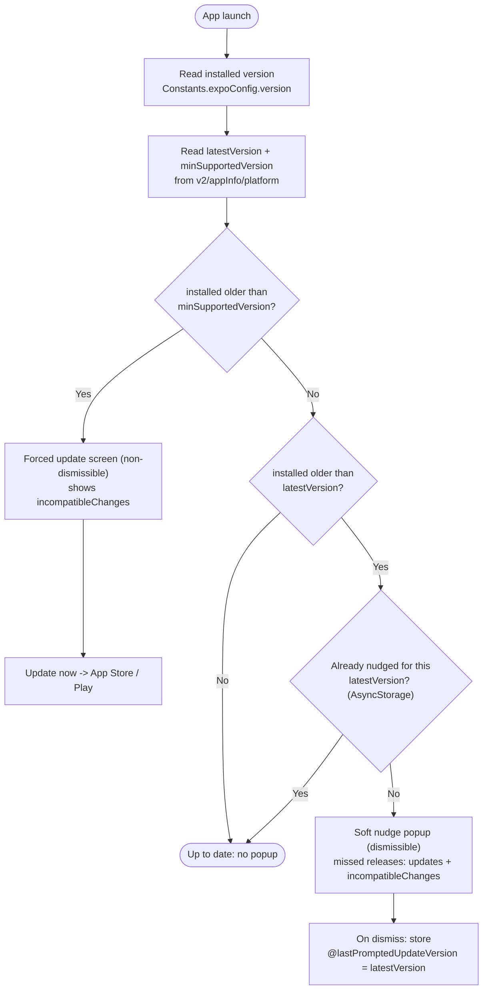
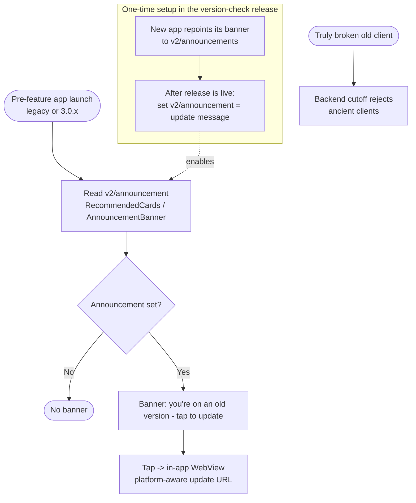

# Version Check & Update Notification

Plan for a system that detects when a user is running an outdated app and
nudges (or, for breaking releases, forces) them to update — while clearly
telling them what they are missing, so we stop "feature X doesn't work"
reports from people on old versions.

Status: **planning**. Decisions below are locked from the design review;
items marked _Open_ still need a call.

---

## Goals

- Tell users on an old version that they are behind, and **what they gain**
  by updating (concise, from the changelog).
- Support two tiers:
  - **Soft nudge** — dismissible "update available" popup.
  - **Forced update** — non-dismissible gate for releases that break old
    clients.
- Avoid support tickets from users whose app silently stopped working after a
  backend/data-contract change.

### What an "incompatible change" looks like

**Going forward — apps that have this version-check feature (this release onward):**

- *New feature the old app can't render.* e.g. 3.3.0 adds a new project type;
  those projects won't open on < 3.3.0. → added to `incompatibleChanges` for
  3.3.0. A user on 3.2.0 gets the **soft nudge** explaining "new X projects need
  the latest app," so they don't file "this project won't open."
- *Backend / data-contract change that breaks old clients.* e.g. 3.5.0 changes
  the contribution payload and the backend stops accepting the old shape, so
  submissions on < 3.5.0 silently fail. → listed in `incompatibleChanges` **and**
  `minSupportedVersion` bumped to 3.5.0 → those users get the **forced-update**
  gate instead of a silently broken app.
- The rule of thumb: *new-but-unusable* → soft nudge (messaging only);
  *your-app-no-longer-works* → force via `minSupportedVersion`.

**Before this — pre-feature apps (legacy + 3.0.x shipped before this release):**

- They can't receive the targeted popup or compute a per-version diff — they only
  render the `v2/announcement` banner. So an incompatible change reaches them as
  either a **silently broken experience** (a project won't load, a submission
  fails) or, better, the **repurposed announcement banner**: a generic "You're on
  an old version — some projects or features may not work. Tap to update."
- They can't be told *which specific* feature broke (no per-version data on an
  old binary), so the message stays generic. For truly-broken cases the real
  enforcement is the **backend cutoff**, with the banner as the heads-up.

## Non-goals / reality checks

- **The version-check popup only works for apps that already contain the
  check.** A user on a build shipped *before* this feature cannot be shown the
  new popup — you cannot inject UI into an already-released binary.
  - **Big exception:** both the **legacy app** (pre-3.0.0 codebase) and the new
    app (**3.0.0+**) read the *same* remote announcement node `v2/announcement`
    with the *same* `{text, url}` shape, so we can nudge essentially the
    **entire field population** through it — see
    [Reaching already-shipped apps](#reaching-already-shipped-apps-via-the-announcement-channel).
  - The remaining lever for *forcing* (vs nudging) the un-upgradeable tail is a
    **backend-side cutoff** (server rejecting ancient clients).
- The in-app forced update is a *graceful* version of what the backend would
  otherwise do ungracefully when it drops support for an old client.

---

## Design decisions (locked)

| Decision | Choice |
| --- | --- |
| Source of truth | **Firebase Realtime Database**, already wired (`utils/firebase.ts`, `onValue`) |
| Node | **Per-platform**: `v2/appInfo/{ios,android,web}` |
| Why per-platform | iOS/Android approve & ship on different timelines; **web will have a completely different versioning scheme** |
| Comparison | **Client-side**: installed version (`Constants.expoConfig?.version`) vs remote `latestVersion` |
| Tiers | `latestVersion` → soft nudge; `minSupportedVersion` → forced update |
| Per-release payload | `{ version, versionCode, updates?, incompatibleChanges? }` — `updates` / `incompatibleChanges` are **markdown** |
| When Firebase is updated | **After the release is actually live in the store**, not at tag time (avoids nagging toward a not-yet-available version) |
| Version comparison key | **semver string** compare in the app (`utils/version.ts`). Firebase range queries use a numeric `versionCode` = `major*1_000_000 + minor*1_000 + patch` (3.0.10 → 3000010), computed by the backend — **not** the Android `versionCode` |
| Localization | Popup strings are in the `appUpdate` i18n namespace (English only for now); release notes are English |
| Soft-nudge cadence | Popup opens **once per `latestVersion`** (AsyncStorage key `@lastPromptedUpdateVersion`); a banner on the projects screen reopens it |
| `appInfo` writer | **Django admin** (mapswipe-backend `AppInfo` / `AppRelease`). Releases can be drafted early; `latestVersion` is picked manually once the release is live in that store. History seeded from `changeLog.json` with `./manage.py import_app_releases` |
| Sequencing | Instrument real app version first → collect distribution → only then enable force-update at a safe floor |

---

## Flows

### Versions going forward (apps that have the version-check feature)



### Versions before this (pre-feature apps: legacy + 3.0.x)



## Firebase data model

```jsonc
// v2/appInfo/ios   (and /android, and later /web)
{
  "latestVersion": "3.1.0",        // picked in the admin once it is live in the store
  "minSupportedVersion": "3.0.0",  // anything below this is force-updated
  "releases": {                    // only releases up to latestVersion (drafts are not pushed)
    // NOTE: keys use "_" because RTDB keys cannot contain "."
    "3_0_9": { "version": "3.0.9", "versionCode": 3000009, "updates": "- …" },
    "3_1_0": {
      "version": "3.1.0",
      "versionCode": 3001000,
      "updates": "- New project filters",
      "incompatibleChanges": "- Projects created after 3.1.0 will not open on older apps"
    }
  }
}
```

- The app reads `latestVersion` / `minSupportedVersion`, then fetches only the
  releases it is missing with a range query:
  `orderByChild('versionCode')`, `startAfter(installed)`, `endAt(latest)`.
  Rules index: `.indexOn: ["versionCode"]` on `v2/appInfo/$platform/releases`.
- **`incompatibleChanges` is messaging only** — true breaking changes *and* new
  features that won't work on older versions. It does **not** force an update;
  forcing is governed **solely** by `minSupportedVersion`.
- **Security rules:** `.read: true` (so the prompt also works on the login
  screen), `.write: false` (written by the backend with the admin SDK).
- iOS and Android are separate rows/nodes: release notes are kept per platform
  and each store goes live on its own timeline.

---

## Implementation

**mapswipe-firebase:** `definition/appInfo.yaml` (`FbAppInfo`,
`FbAppInfoRelease`), regenerated `pyfirebase`, `appInfo` rules + index.

**mapswipe-backend:**
- `AppInfo` (one row per platform, created by the migration) with
  `min_supported_version` and `latest_version` (a release of that platform).
- `AppRelease` (inline in the admin): `version`, `updates`,
  `incompatible_changes` (markdown); unique per platform + version.
- Saving in the admin pushes the whole `v2/appInfo/{platform}` node
  (`FirebaseAppInfoPush`).
- `./manage.py import_app_releases` seeds releases from `changeLog.json`.

**mapswipe-mobile:**
- `hooks/useAppUpdate.ts` — reads app info and the missed releases.
- `components/AppUpdatePrompt.tsx` — soft (dismissible) / hard (blocking) popup,
  mounted in `app/_layout.tsx`; `components/AppUpdateBanner.tsx` on the
  projects screen reopens it.
- `utils/appStore.ts` — store links (Play Store, App Store id `1133855392`).
- Telemetry: contributions carry the real `appVersion` / `clientType`.
- The post-update `ChangeLogModal` (bundled `changeLog.json`) is unchanged.
- Local testing: `EXPO_PUBLIC_FIREBASE_DATABASE_EMULATOR_HOST` /
  `EXPO_PUBLIC_FIREBASE_AUTH_EMULATOR_HOST` (dev only); search
  `TEST_VERSION_CHECK` to test on web or fake the installed version.

---

## Required features

> To add a new feature, follow
> [mapswipe-backend `docs/app-features.md`](https://github.com/mapswipe/mapswipe-backend/blob/develop/docs/app-features.md).

A version number says *whether* an app is old, not whether it can open a
specific project. Example: an older app showed a fallback image instead of a
Completeness vector overlay (or Validate pre/post-event imagery) and still
accepted answers. So resources declare the **features** they need, and each
client checks them against the features it supports.

- **Catalogue:** `AppFeatureEnum` in the backend (`apps/common/models.py`).
  Value = name (eg. `PROJECT_COMPLETENESS_VECTOR_LAYER`), prefixed by area
  (`PROJECT_`, `TUTORIAL_`, `MAPPING_`, …). Only add, never rename or remove.
  Exposed via GraphQL `enums { AppFeatureEnum { key label } }`, so app codegen
  generates the TypeScript enum.
- **Required:** `requiredFeatures: string[]` on projects and tutorials in
  Firebase, derived by the backend from the configuration
  (`get_required_features()` per project type), pushed on create and update.
  `./manage.py push_required_features` backfills data already in Firebase.
- **Supported:** each app bundles `SUPPORTED_FEATURES` (`constants/features.ts`).
  `AppRelease.supported_features` (checkboxes in the admin) is pushed as
  `releases/{key}/supportedFeatures`; when set for the installed version it
  **replaces** the bundled list (eg. to withdraw a buggy feature). Empty = use
  the bundled list.
- **Check:** `useFeatureSupport(requiredFeatures)` — missing = required −
  supported; **unknown keys count as missing**. Projects stay visible with an
  "Update needed" / "Not supported" badge; the project page replaces
  *Start tutorial* / *Map now* with the reason. If a newer release lists the
  missing features in `supportedFeatures`, it says "Update to X".
- **Labels** come from the GraphQL query and are cached (AsyncStorage), so an
  old app can name a feature added after it was released.
- **Order:** ship clients with the check before any project uses a new feature.
  Apps without the check ignore `requiredFeatures`; for them, use
  `minSupportedVersion`. Rejecting answers from unsupported apps (eg. by
  `appVersion` in results) is a separate decision.

---

## Work: MapSwipe Web (future)

- [ ] Separate `v2/appInfo/web` node with its **own versioning scheme** (web is
      not semver-aligned with mobile; define its version source — build hash /
      date / independent semver).
- [ ] UX differs from mobile: a web "update" is a **reload**, not a store trip.
  - Soft nudge → banner/toast: "A new version is available — refresh."
  - Forced → block the UI and require a hard reload (also handles cache-bust).
- [ ] Decide how web learns its own running version (injected at build time).

---

## Reaching already-shipped apps via the announcement channel

The version-check popup only runs in builds that contain it, but there is a
channel that *already-shipped* apps render and that we control remotely: the
**announcement banner**. We can repurpose it to nudge the pre-feature tail —
and it reaches **both codebases**:

- **New app (3.0.0+):** `components/AnnouncementBanner.tsx` reads
  `v2/announcement` (`FbAnnouncement = { text, url }`) and shows a tappable
  banner on the projects screen (`app/(auth)/(home)/projects.tsx`). Tapping
  opens `url` in the in-app WebView (`/WebviewWindow`). **No dismissal** — a
  persistent nudge. Shipped since v3.0.0.
- **Legacy app (pre-3.0.0 codebase):** `src/shared/views/RecommendedCards.js`
  reads the **same node** `v2/announcement` (line 112) and renders the same
  `announcement.text` / `announcement.url` (lines 286 / 275), opening the URL in
  its WebView.

Because both read the **same node with the same shape**, a single
`{ text, url }` written to `v2/announcement` renders for essentially the entire
field population across both apps.

### Plan: migrate new apps to a new node; repurpose the old node for "update"

- [ ] In the release that introduces version-check, point `AnnouncementBanner`
      at a **new** node (e.g. `v2/announcements`). Move any live announcement
      content there.
- [ ] **After** that release is live in the stores, set the **old**
      `v2/announcement` node to the update message, e.g.
      `{ "text": "You're on an old version of MapSwipe — tap to update.", "url": "<platform-aware update URL>" }`.
- [ ] Result: apps that have **not** updated keep reading `v2/announcement` and
      see the nudge; updated apps read the new node and see normal announcements
      only.

### Constraints (frozen in old apps — cannot be changed)

- **Banner only — no modal, no forced gate.** The pre-feature tail can only get
  this persistent banner; forced update stays exclusive to feature-bearing apps.
- **`v2/announcement` is not per-platform and `url` is a single field**, so it
  can't deep-link both stores. Point `url` at a **platform-detecting landing
  page** (e.g. `mapswipe.org/app`); it opens in the in-app WebView, so a store
  *web* page (one extra tap) is expected.
- **Sequencing:** do not set the update message before the new release is live,
  or users on the current-latest (who still read the old node until they
  update) will wrongly see "please update".
- **One-way:** repurposing the old node means you can no longer send normal
  announcements to old apps. Intended trade-off.
- **Reach is broad but not universal:** it covers any app that renders
  `v2/announcement` — the legacy app (via `RecommendedCards`) and the new app
  (via `AnnouncementBanner`). Only builds with no announcement feature at all are
  unreachable; for *forcing* that residue, a backend-side cutoff is the lever.

## Suggested rollout order

1. **Phase 1 (now):** fix the `appVersion` FIXME (telemetry) + ship the **soft
   nudge** + **repoint `AnnouncementBanner` to the new `v2/announcements` node**
   (so the old node can later be repurposed). Harmless without force-update;
   starts data collection.
2. **Phase 2:** stand up `v2/appInfo/{ios,android}` from the Django admin and
   set `latestVersion` once each store is live. **After this release is live**, flip the old
   `v2/announcement` node to the "please update" message for the pre-feature
   tail.
3. **Phase 3:** once the old-version tail is small enough, enable **forced
   update** via `minSupportedVersion`; consider a backend cutoff for the
   unreachable pre-feature tail.
4. **Phase 4:** MapSwipe Web.

---

## How to read the current field distribution (to set the floor)

- **Google Play Console → Statistics** — active devices/installs by App
  version (authoritative, Android).
- **App Store Connect → Analytics → Metrics** — grouped by App Version
  (sampled/opt-in, iOS).
- **Your own DB** — once the `appVersion` FIXME is fixed, query contribution
  records for the live distribution of active users (best signal for the
  floor).
